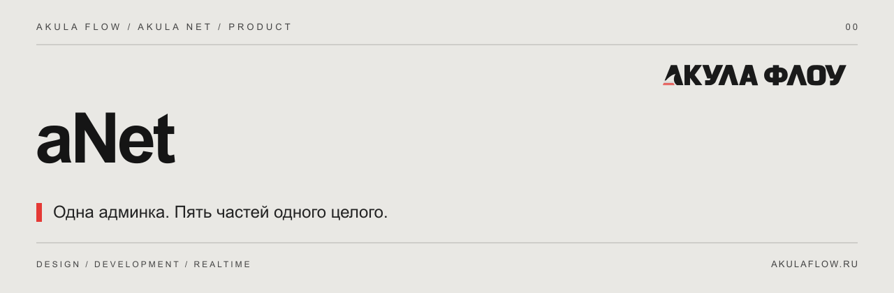

[Сайт](https://akulaflow.ru/) · [GitHub](https://github.com/yanakulov/anet) · [GitVerse](https://gitverse.ru/yanakulov/anet) · [Changelog](CHANGELOG.md)

# Akula Net · aNet 1.0.0

**Единая админка сайта и подключаемых модулей Акулы.**

Страницы, пользователи, медиа и SEO образуют основу. Визуальный редактор, задачи, публикации и расширенная аналитика подключаются к ней через общий интерфейс.

## Модули

| Продукт | Назначение | Репозитории |
|---|---|---|
| **aNet** | Единая админка и подключаемые модули | [GitHub](https://github.com/yanakulov/anet) · [GitVerse](https://gitverse.ru/yanakulov/anet) |
| **aCore** · Сердце Акулы | Страницы, пользователи, медиа и SEO — в одном интерфейсе. | [GitHub](https://github.com/yanakulov/acore) · [GitVerse](https://gitverse.ru/yanakulov/acore) |
| **aVision** · Глаза Акулы | Визуальное редактирование сайта через настоящие Vue-компоненты. | [GitHub](https://github.com/yanakulov/avision) · [GitVerse](https://gitverse.ru/yanakulov/avision) |
| **aFlow** · Поток Акулы | Проекты, доски, задачи и команда внутри aNet. | [GitHub](https://github.com/yanakulov/aflow) · [GitVerse](https://gitverse.ru/yanakulov/aflow) |
| **aJaws** · Пасть Акулы | Кросспостинг и расписание публикаций для Telegram и VK. | [GitHub](https://github.com/yanakulov/ajaws) · [GitVerse](https://gitverse.ru/yanakulov/ajaws) |
| **aSense** · Чутьё Акулы | Подробная аналитика, цели и поведение посетителей. | [GitHub](https://github.com/yanakulov/asense) · [GitVerse](https://gitverse.ru/yanakulov/asense) |

## Принципы

- **Одна установка, один контекст.** Общая авторизация, пользователи и роли.
- **Модули под задачу.** Новый клиент получает aCore; aVision, aFlow, aJaws и aSense изначально выключены.
- **Права проверяет сервер.** Наличие пункта меню или клиентского скрипта не предоставляет доступ.
- **Публикация отделена от черновика.** Отключение модулей не снимает опубликованные страницы с сайта.
- **Данные на сервере.** PostgreSQL для контента, файлы WebP/AVIF для медиа, отдельное приватное хранение ключей.

## Технологии

Vue · Nuxt · TypeScript · Node.js · PostgreSQL. AF Core / Vue / Nuxt / Editor / Licensing: **0.2.0**. Для отдельных модулей используются TDLib, VK OAuth и приватный Umami.

## О репозитории

Это публичный информационный репозиторий: описание продукта и журнал изменений. Исходники развиваются в приватных репозиториях. Публикация описания не предоставляет лицензию на программное обеспечение.

Сайт и связь со студией: [akulaflow.ru](https://akulaflow.ru/).
